


  

## About

I came to AI from the business side, and it shapes how I build. I judge a system by whether an organisation can rely on it: whether it explains its decisions, shows its sources, and admits when it doesn't know. My MSc in Business Analytics taught me to ask that question. The projects below are how I answer it.

## Projects

  <a href="https://github.com/Dharshiny5/n8n-agentic-rag-conc-compliance"></a>
  <a href="https://github.com/Dharshiny5/n8n-balance-sheet-review"></a>

  <a href="https://github.com/Dharshiny5/loan-approval-agentic-ml-n8n"></a>
  <a href="https://github.com/Dharshiny5/dual-agent-rag-gdpr-ai-act"></a>

  <a href="https://github.com/Dharshiny5/returns-automation-n8n"></a>
  <a href="https://github.com/Dharshiny5/n8n-esg-risk-scoring"></a>

  <a href="https://github.com/Dharshiny5/n8n-rag-pinecone-policy-qa"></a>
  <a href="https://github.com/Dharshiny5/sdg-rag-ollama"></a>

  <a href="https://github.com/Dharshiny5/local-rag-olama"></a>

## Toolkit


## Education

- **MSc Business Analytics (Merit)**, Queen's University Belfast
- **BBA with Computer Application (Distinction)**, Dr. N.G.P. Arts and Science College

 

